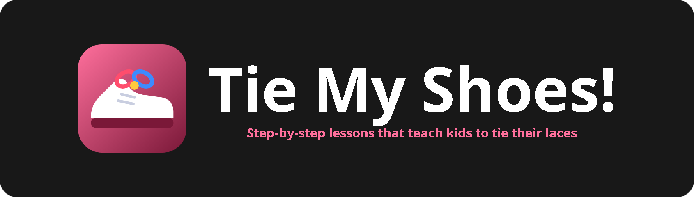
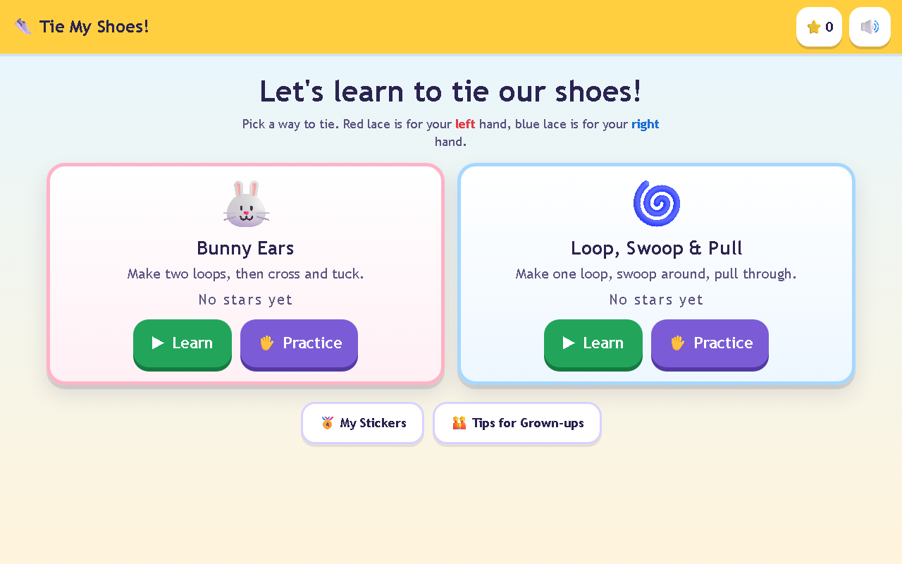

<p align="center"></p>

<p align="center">    </p>

A friendly app that teaches kids (about 4 to 8 years old) to tie their shoelaces. Each lesson shows a shoe with a red left lace and a blue right lace, animates every move, and reads the instructions aloud. A practice mode lets kids try the moves themselves and earn stars and stickers.

<p align="center"></p>

## Features

- Two methods: Bunny Ears (9 steps) and Loop, Swoop & Pull (8 steps)
- Smooth SVG animations with a guiding finger and arrows for each step
- One-line instructions read aloud with speech synthesis, plus Back, Again and Next
- An original rhyme for each method
- Practice mode: drag the glowing lace end to the star, with gentle feedback and a "Show me" hint
- Stars, stickers and a confetti celebration, plus tips for grown-ups
- Big touch targets, ARIA labels and reduced-motion support

## Getting started

No build step and no dependencies. Clone the repo and open `index.html`, or serve the folder locally:

```bash
git clone https://github.com/Squidly1408/shoelace-tutor.git
cd shoelace-tutor
python -m http.server 8779
```

Then visit http://localhost:8779.

## Project structure

| File | Purpose |
|---|---|
| `index.html` | App shell |
| `app.js` | Lessons, animation and practice logic |
| `styles.css` | Styles |
| `assets/` | Logo and README images |

## Built with

HTML, CSS, JavaScript (SVG, Speech Synthesis API), localStorage

## Limitations

- Knots are simplified drawings rather than true over-and-under lacing
- Voice quality depends on the device
- Not yet tested on a real touchscreen

## License

Released under the [MIT License](LICENSE).
